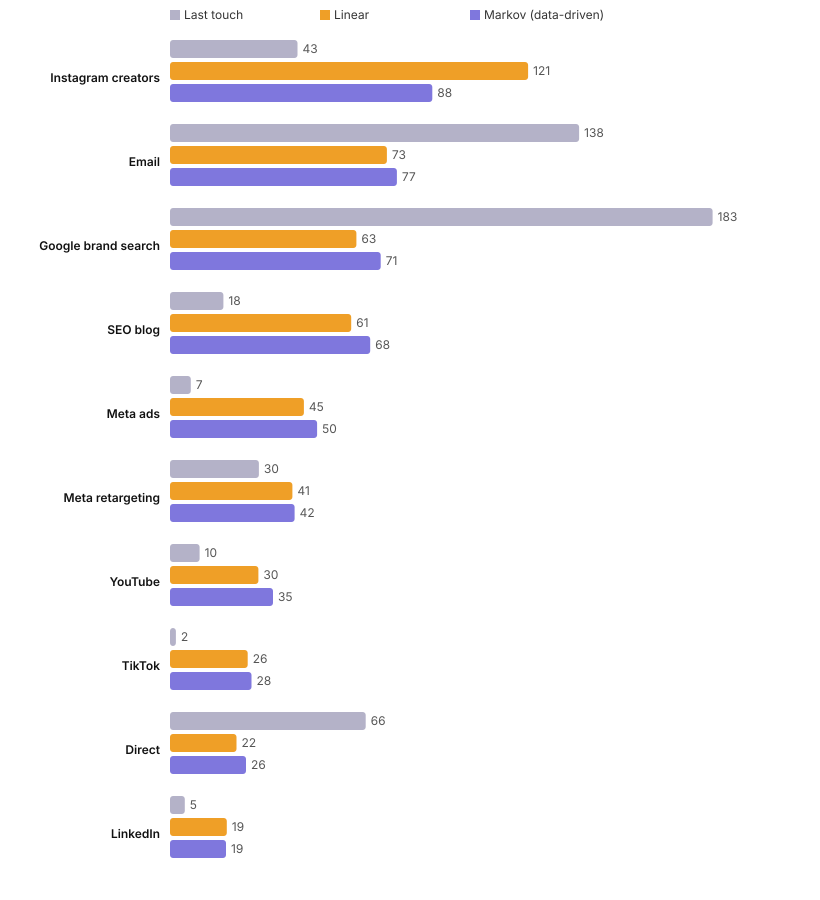

# Marketing Attribution Lab

**Which channels actually drive sales? Six attribution models, side by side, on the same customer journeys.**

Most teams judge channels on last-click numbers from their ad platform. That systematically over-credits the channels that *close* (brand search, email, direct) and under-credits the ones that *start* the journey (creators, content, social). Budgets then move the wrong way.

This lab runs five classic models and one **data-driven Markov chain model** on the same journeys and shows where they disagree.



```
$ attribution data/journeys.csv

| Channel             | Last touch | First touch | Linear | Time decay | Position | Markov |
| Instagram creators  |         43 |         199 |    121 |        103 |      121 |     88 |
| Email               |        138 |           0 |     73 |         88 |       71 |     77 |
| Google brand search |        183 |           0 |     63 |         85 |       79 |     71 |
| SEO blog            |         18 |          71 |     61 |         55 |       52 |     68 |
```

> **Instagram creators** gets 88 conversions under the data-driven model but only 43 under last touch. Cutting it on last-touch numbers would hurt total sales.
> **Google brand search** gets 183 under last touch but 71 under the data-driven model. It mostly captures demand other channels created.

Full output: [`reports/attribution.md`](reports/attribution.md). Journeys are fictional, from [`attribution/sample.py`](attribution/sample.py).

## The models

| Model | Credit rule | Good for |
|---|---|---|
| Last touch | 100% to the final touch | What platforms report by default |
| First touch | 100% to the first touch | Which channels create demand |
| Linear | Equal split | A neutral baseline |
| Time decay | Halves every 2 steps back | Short sales cycles |
| Position based | 40% first, 40% last, 20% shared in between | Valuing both discovery and closing |
| **Markov (data-driven)** | Removal effect: how much total conversion probability drops if a channel disappears | Learning from the data instead of assuming a rule |

**How the Markov model works.** Every journey becomes a path through states: start → channels → conversion or drop-off. The model learns transition probabilities between them, calculates the overall chance of converting, then removes each channel in turn and recalculates. The bigger the drop, the more that channel matters. Conversions are shared in proportion to those drops.

## Run it

```bash
git clone https://github.com/Vishwajeetkumbhar379/marketing-attribution-lab
cd marketing-attribution-lab
pip install -e ".[dev]"
attribution data/journeys.csv
pytest
```

**Input:** `user_id, path, converted, revenue`, with the path as channels joined by ` > ` (for example `TikTok > Email > Google brand search`). Most analytics tools can export this from user-level data.

Tests check that every model credits exactly the number of conversions, and that the data-driven model rewards assisting channels.

## Why I built it

I spent years on creator campaigns whose value often didn't show up in last-click reports, even when sales clearly moved. This makes that argument with numbers, and it applies to any channel mix: paid social, search, email, SEO or creators.

---

Built by [Vishwajeet Kumbhar](https://www.linkedin.com/in/vishwajeetkumbhar379) with Claude Code. MIT licence.
